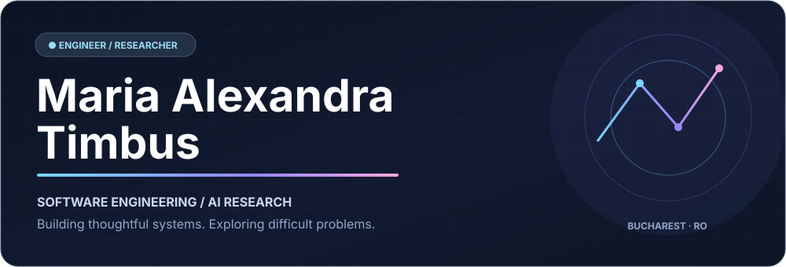

  

<strong>OPEN PROJECT REPOSITORIES</strong>

- [NYC Real Estate / Custom SVD](https://github.com/mariatimbus/NYC_RealEstate)
- [Scientific Computing Solvers](https://github.com/mariatimbus/Scientific-computing-solvers)
- [Trading Strategies & Backtesting](https://github.com/mariatimbus/Trading-Strategy-and-Perform-Backtesting)
- [Opportunity Tracker](https://github.com/mariatimbus/Opportunity-Tracker-)
- [Stellar Spectra Classification](https://github.com/mariatimbus/Classifying-Stellar-Spectra-with-Python-and-TensorFlow)
- [SmartHack / Office Planner](https://github.com/mariatimbus/Smarthack2025-Officeplanner)

